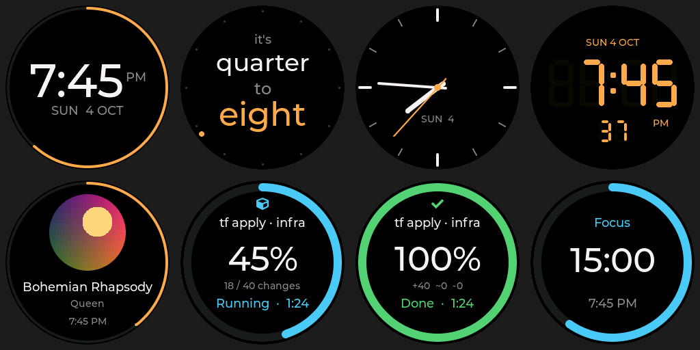

# W6 "Walnut": Qi charger stand with a round screen

A 3D-printed desk stand that charges a phone wirelessly (Qi) and has a 1.28" round display in its base. The screen shows
a clock. With the companion Android app, it also shows the phone's charge and what's playing.
Anything that can send an HTTP request can put progress rings, timers and notifications on it.




One stand has been built and is in daily use.

## What it does

- **Clock** with nineteen faces: digital, analog dials, seven-segment, the time in words and a shell prompt, plus six
  living faces that compute every pixel: a tunnel, aurora, a turning galaxy, silk, the sky and a walnut-grain dial.
  12- or 24-hour time, in the phone's time zone.
- **Phone charging screen** and **now playing** with round album art and the track's progress, sent by the Android app.
- **Progress rings** for a `terraform apply`, a GitHub Actions run or a backup script, plus a focus timer and short
  notifications. A small command-line tool wraps the API.
- **A small daily surprise.**
- **Setup from a phone** by QR code, **updates over Wi-Fi** that roll back if they break, and a start history that tells a
  power cut from a crash.

## How it works

```
USB-C supply ──► Qi transmitter board (AYS-K9-15W) ──► coil in the backrest ──► phone
                     │ its +V / −V input pads
                     ▼
                 buck converter (HW-133, set to ≈4.2 V) ──► ESP32-C3 SuperMini "5V" pin
                                                              │ 3.3 V regulator on the ESP32
                                                              ▼
                                                     GC9A01 round display (SPI)
```

The ESP32 doesn't talk to the phone directly: the phone app sends the stand its charge and music over the home Wi-Fi.

| Part | What it is |
|---|---|
| Printed | Base (white PLA body with a brown foot band), cap, backrest, coil cover, lip, bottom plate, display retainer: plain PLA, no supports |
| Bought | Qi transmitter board + Ø50 coil, GC9A01 240 × 240 round display, ESP32-C3 SuperMini, HW-133 mini buck converter, 10 × M2 × 5 countersunk screws |
| Consumables | Thin stranded wire, heat-shrink, double-sided tape, hot glue, CA glue, solder, rosin flux |

## Start here

| If you want to… | Read |
|---|---|
| Print and build one | [`cad/BUILD.md`](cad/BUILD.md) |
| Set it up, use the API, change what the screen does | [`firmware/w6/README.md`](firmware/w6/README.md) |
| Build or install the phone app | [`android/README.md`](android/README.md) |

## Folder map

| Path | What |
|---|---|
| `cad/w6.py` | The enclosure, parametric ([build123d](https://github.com/gumyr/build123d)). Every size is here |
| `cad/bought.py` | Simple models of the bought parts, from measurements |
| `cad/check.py` | Collision check between printed and bought parts (wires, solder and tape aren't modelled) |
| `cad/export.py`, `cad/plates.py`, `cad/slice.py` | Export 3MF/STL/STEP, arrange shared build plates, slice with OrcaSlicer's CLI |
| `cad/out/print/`, `cad/out/plates/`, `cad/out/coupons/` | Print-ready parts, shared plates and fit-test pieces |
| `cad/out/w6_assembly.step` | All printed parts in place, for other CAD tools |
| `cad/render_w6.py`, `cad/renders/` | Blender renders from the print files (helpers in `concept/common.py`) |
| `firmware/w6/` | The stand's firmware (PlatformIO, Arduino, LVGL 8.3), its API and the `w6` command-line tool |
| `android/` | The W6 Android app (Kotlin, Compose, Material 3) |

## Tools

- Python 3.12 with build123d 0.13, lib3mf 2.5 and trimesh 5.1 (`python3 -m venv .venv`, then install those)
- Blender 4.0 for renders, OrcaSlicer 2.4 or Bambu Studio 2.x for slicing
- PlatformIO 6 for the firmware
- JDK 21 and the Android SDK for the app (versions in `android/README.md`)

## Safety

- **Never connect the ESP32's USB while the buck converter feeds its 5V pin.** Two supplies on one rail can damage either.
- **Never put the buck's output on 3.3 V or on the display's VCC.**
- **Unplug everything before soldering or checking continuity.**
- **Only a plain 5 V USB supply has been tested.** A QC/PD fast-charge adapter may push 9–12 V into the buck converter,
  whose real input rating isn't known.
- **PLA softens near 55–60 °C.** The Qi coil warms the backrest during long charges; watch for warping.
- **The case is sealed.** Firmware updates go over Wi-Fi and roll back by themselves if the new version can't get online,
  but anything worse means taking the bottom plate off. See "Living with a sealed case" in the firmware README.
- **The API is plain HTTP with a token.** Keep the stand on a home network and don't expose it to the internet.

## License

[MIT](LICENSE): the CAD files, firmware, app and docs. The bundled fonts, icons and a few borrowed files keep their own
licences; see [`THIRD_PARTY_NOTICES.md`](THIRD_PARTY_NOTICES.md).
