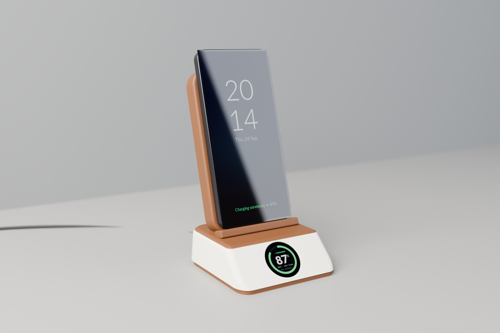
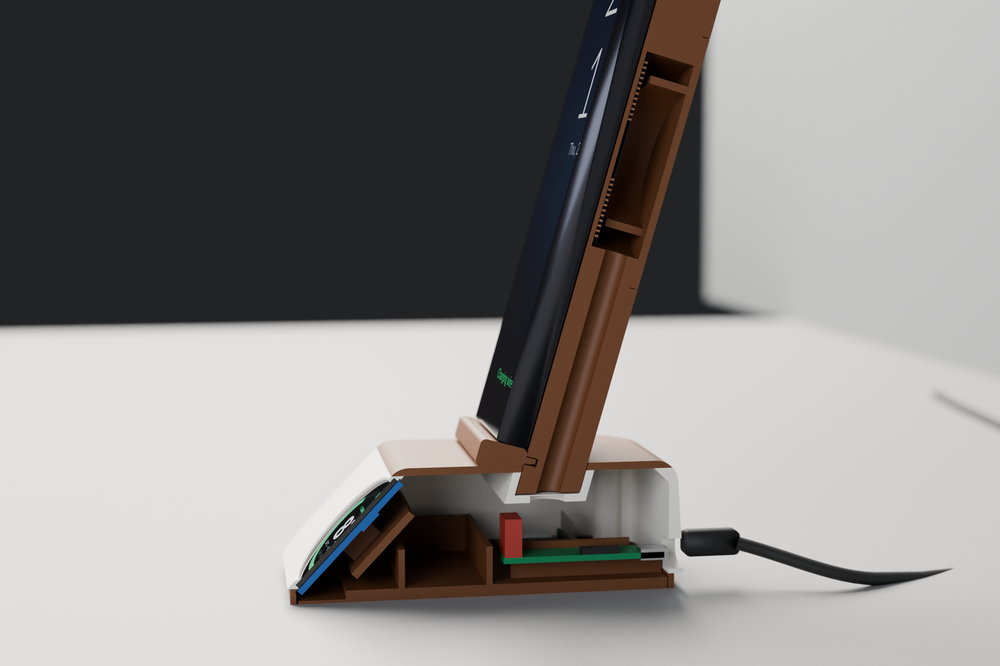
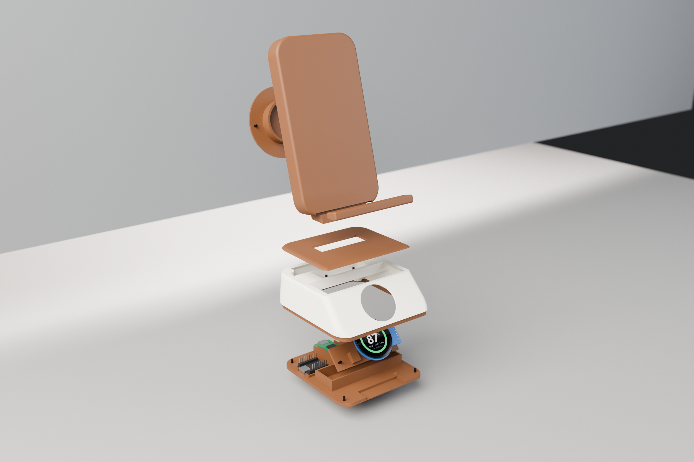
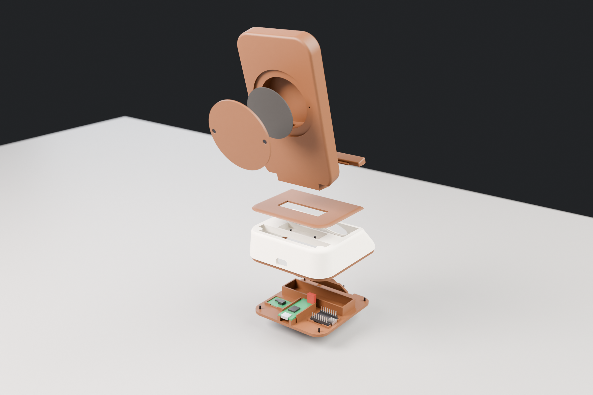

# W6 "Walnut" charger stand: build guide

How to print, wire and assemble one stand. Every size comes from `w6.py`; the print files in `out/` are made from it.

| Render | |
|---|---|
|  |  |
|  |  |

Rendered from the print files. Filament shades are assumed, the screen content is illustrative, wires aren't drawn, and the
Qi board's film capacitor is modelled upright (the real one lies sideways toward the ESP32, which is fine).

## Parts

### Printed (plain PLA, Bambu Lab A1, 0.4 mm nozzle, 0.2 mm layers, no supports)

| File | Colour | Orientation (already set in the file; don't rotate) | Settings |
|---|---|---|---|
| `out/print/base.3mf` | white, then brown | upside down, front towards the printer's left | 3 walls, 15 % gyroid. **Change filament to brown at 28.0 mm** (the last 4 mm is the foot band) |
| `out/print/cap.3mf` | brown | right side up | 100 % infill (it's 2.0 mm thick) |
| `out/print/backrest.3mf` | brown | phone face on the plate, long side left to right | 3 walls, 15 % gyroid; keep the 1.2 mm skin over the coil solid (5+ top/bottom layers) |
| `out/print/coil_cover.3mf` | brown | outer face down | |
| `out/print/plate.3mf` | brown | as is | 4 walls, so the 3 mm plate is solid |
| `out/print/retainer.3mf` | brown | as is | |
| `out/print/lip.3mf` | brown | flat bottom down | |

Each part also comes as an STL. `out/plates/` has the same parts pre-arranged on shared beds: `brown_parts` (backrest,
cap, coil cover) and `bottom_parts` (plate, retainer, lip). The base always prints alone because of its colour change.
`out/print/feet.3mf` is optional: four TPU feet for the plate's recesses. Hot glue works just as well (see step 11).

| Part | Time | Weight |
|---|---|---|
| base | 1 h 34 min | 48 g |
| cap | 23 min | 14 g |
| backrest | 1 h 44 min | 65 g |
| coil cover | 23 min | 10 g |
| plate | 47 min | 27 g |
| retainer | 15 min | 3 g |
| lip | 19 min | 4.5 g |

About 5 h 25 min and 170 g of PLA (about 45 g white, 125 g brown), from the slicer's estimates.

Printing notes:
- Bambu Studio says the 3MF files aren't from Bambu Lab and offers to load the geometry only: say yes, keep the
  orientation, and don't auto-orient.
- The base: slice it, drag the layer slider to 28.0 mm, right-click and add a filament change. With an AMS Lite this
  needs no manual swap.
- The base and backrest face their overhangs towards the printer's left because the A1 cools from the left of the head.
  Turned the other way, the base's front corner comes out rough.
- The base starts on a rim only 1–5 mm wide. Clean the plate; add a 5 mm inner brim if the first layer lifts.
- The socket floor inside the base is a 16 mm bridge. Its three holes are printed closed with a 0.2 mm skin so the bridge
  prints solid; you open them in step 2.
- The backrest's phone face prints on the bed and takes the plate's texture.
- PLA softens near 55–60 °C. If the backrest face ever warps from the coil's heat, reprint it in PETG.

### Fit-test pieces (optional, about 2 hours in total)

Printers differ. These small pieces in `out/coupons/` check the fits that matter before the big prints:
- **`coupon_screws`**: M2 pilot holes of 1.6, 1.7 and 1.8 mm (1, 2 and 3 notches) and a loose tab. Screw the tab onto
  each hole with an M2 × 5 and keep the size where the screw cuts its thread firmly, pulls the tab flat and doesn't spin.
  If it isn't 1.7, change `PILOT_D` in `w6.py` and re-export.
- **`coupon_glass`**: only the sloped wall around the display. From the back, the display's glass should drop into the
  round pocket with its ribbon strip in the notch, snug, and sit flat on the ledge.
- **`coupon_display_face`**: the sloped face with the display window and the two retainer bosses.
- **`coupon_coil_pocket`**: the coil should drop into the Ø51 pocket.
- **`coupon_socket` + `coupon_tenon`**: the tenon should slide into the socket with light friction, and the slab's
  corner shoulders should sit flat on top. The tenon coupon also has the lip groove.

### Bought

| Part | Qty | Notes |
|---|---|---|
| Qi transmitter board AYS-K9-15W + Ø50 coil | 1 | USB-C input; input pads labelled +V / −V |
| GC9A01 1.28" 240 × 240 round display, 7-pin header | 1 | |
| ESP32-C3 SuperMini | 1 | with its two 8-pin headers soldered on |
| Mini adjustable buck converter (HW-133, sold as "MP1584") | 1 | set to about 4.2 V |
| M2 × 5 countersunk screws | 10 | plate 4, backrest 2, display retainer 2, coil cover 2 |
| Thin flexible stranded wire, heat-shrink, double-sided tape, hot glue, CA glue | | |
| Solder and **rosin or "no-clean" electronics flux** | | not plumbing (acid) flux: it corrodes joints over months |
| USB-C cable and a 5 V USB adapter | 1 | see "Power" below |
| 1 mm foam tape | | optional, for the coil cover |
| 100–150 g ballast (coins, steel nuts) | | optional, see "Ballast" |

Bought-part sizes used in the CAD (measured):

| What | Size | Where it matters |
|---|---|---|
| Qi board | 42.5 × 17 mm; USB-C sunk into a cut-out, 3 mm tall, ~0.5 mm below the board, 1 mm past its end | cradle on the plate; the port lines up with the 14 × 8 mm opening at the back |
| Film capacitor on the Qi board (404J 100 V) | 10 × 8.5 × 4.5 mm | leave it as supplied; the shell closes over it |
| Qi coil | Ø50, 2.0 mm thick (1 mm ferrite), centre hole Ø5 | Ø51 pocket in the backrest |
| GC9A01 carrier board | Ø37.7, 45.1 mm long with its header tab (22.6 mm wide) | display pocket, retainer |
| GC9A01 glass | 36.0–36.2 mm; 3.0 mm from glass front to board back | Ø36.6 glass pocket |
| Display header | 2.6 mm plastic + 5.3 mm pins, on the back of the tab | retainer window, plate notch |
| ESP32-C3 SuperMini with headers | 22.6 × 18.6 × 10.5 mm | tray under the socket beam |
| Buck converter | 21.8 × 16.8 × 4.2 mm | tray on the plate |

Assumed: a phone of about 77 × 163 × 9 mm. The coil sits 85 mm up the backrest, at a typical phone's middle, and the
lip is 12.5 mm deep, enough for about 12 mm of phone plus case.

## Power

```
USB-C ─► Qi board ─► coil in the backrest ─► phone
           │ +V / −V input pads
           ▼
         buck converter (≈4.2 V) ─► ESP32-C3 "5V" pin ─► its 3.3 V regulator ─► display
```

- The USB cable plugs into the Qi board only. Two wires from its +V / −V input pads feed the buck converter.
- A 5 V USB supply can't give 5.0 V through a buck converter, so set it to **about 4.2 V**. The ESP32's regulator is
  happy with that.
- The display runs from the ESP32's 3.3 V pin, never from the buck.
- **Only a plain 5 V supply has been tested.** A QC or PD fast-charge adapter may raise the Qi board's input to 9 or
  12 V, which then reaches the buck converter. Its real input rating isn't known (the chip marking is unclear).
- **Never plug USB into the ESP32 while the buck feeds its 5V pin.** Two supplies on one rail can damage either.

## Wiring

| Display pad | ESP32-C3 pin |
|---|---|
| VCC | 3.3 |
| GND | G |
| SCL | GPIO 4 |
| SDA | GPIO 6 |
| DC | GPIO 5 |
| CS | GPIO 7 |
| RST | GPIO 10 |

| From | To |
|---|---|
| Qi board +V / −V input pads | buck IN+ / IN− |
| buck OUT+ | ESP32 5V |
| buck OUT− | ESP32 G (shared with the display's GND) |

- GPIO 2, 8 and 9 are avoided: they decide how the chip boots.
- About 120 mm of thin stranded wire per line, so the plate can lie next to the base while you work. That length is
  clean at the 40 MHz SPI clock.
- **No push-on (Dupont) plugs.** On the display they would reach below the desk, and on the ESP32 they hit the socket
  beam. Solder every wire straight onto its header pin, close to the black plastic, sleeve it with 6–8 mm of heat-shrink
  and bend it sideways along the pins. There's about 2.5 mm of room past the pin tips.
- The ESP32 lies **pins up**, USB-C towards the left wall. Its labels are underneath, so seen from above, **left and
  right are mirrored**. Check each pin against a pinout photo of the underside.

## Before you start

- **Flash the ESP32 first**, on the bench over USB, with nothing else connected (`firmware/w6`,
  `pio run -e c3 -t upload`). Inside the stand its USB port is unreachable; later updates go over Wi-Fi.
- **Set the buck converter on the bench.** Feed it from the USB supply, nothing on its output. First check that turning
  the trimmer actually changes the output (a dud one stays put; don't force it), then set about 4.2 V.
- **Measure your supply** at the Qi board's input. A typical USB adapter gives 5.1–5.2 V unloaded and dips under load.
- **Measure the coil's leads.** The route from the coil pocket down the backrest tunnel and through the base to the Qi
  board is about 85–95 mm, longer than most factory leads. Plan on extending them (step 3).

## Assembly

The order keeps the stand flipped as few times as possible. Work with the base upside down on a soft cloth, and the
plate lying next to it.

1. **Pre-cut the threads.** Drive an M2 × 5 into every pilot hole once and back it out, slowly and straight: 4 plate
   bosses and 2 display-retainer bosses in the base, 2 in the bottom of the backrest tenon, 2 for the coil cover on the
   back of the backrest. It's much easier now than with wires in the way.
2. **Open the socket floor.** From inside the base, cut the 0.2 mm skin out of the Ø9 wire hole with a hobby knife and
   push an awl through the two screw holes.
3. **Extend the coil leads.** Factory Qi coil leads are usually Litz wire: fine enamelled strands under a woven sleeve,
   which solder won't wet until the enamel burns off. Use flux and heat, not more solder. Splice about 5 cm of stranded
   wire onto each lead, tug-test it, check it with the meter's continuity beep while you flex it (the beep must stay
   solid), and sleeve each splice in its own heat-shrink. If the leads are already soldered to the Qi board, unsolder
   them there and note which pad each went to.
4. **Coil and backrest.** Put the coil in its pocket, copper towards the phone. Feed the leads down the backrest tunnel
   so they come out of the tenon's bottom. Optionally put 1 mm foam on the cover's tube, then screw the cover on
   (2 × M2 × 5). Push the tenon through the cap and into the base's socket, threading the leads through the Ø9 hole,
   until the slab's corners sit on the cap. Screw it from inside the base (2 × M2 × 5). These screws also clamp the cap;
   glue isn't needed.
5. **Charging test.** Solder the coil leads to the Qi board's coil pads, as they were. Plug USB into the Qi board, put a
   phone on the backrest, and check that it charges. Everything is still easy to reach if it doesn't.
6. **Display.** Solder the 7 wires to the display's header pins (see Wiring). Set the display in its pocket from inside
   the base: glass towards the window, header tab towards the base's right side as seen from the front. A layer of thick
   double-sided tape between the board and its seat takes up any play. Screw the retainer on (2 × M2 × 5).
7. **Boards on the plate.** Slide the Qi board into its cradle, USB-C towards the back, and fix it with tape plus hot glue
   at its front end: nothing else stops a pushed-in USB plug from sliding it forward. Tape the buck converter and the
   ESP32 (pins up, USB-C towards the left wall) into their trays. **Fix every board before step 10**: folding the plate
   on turns it upside down.
8. **Wire the ESP32.** Buck output to 5V and G first, then the display's 3.3, then GPIO 4, 10, 5, 6 and 7. Wire the Qi
   board's +V / −V pads to the buck's input. Before power-up, check with the meter that there's no short between 5V, G
   and 3.3. Put a dab of hot glue over any bare wire at the coil pads.
9. **First power-up**, with the plate still beside the base. The Qi board's LED comes on and the screen shows a QR code
   for setup. Set it up now (see `firmware/w6/README.md`) and **save the API token on the computer you'll update from**.
   Check that the phone still charges with the screen on.
10. **Close.** Optionally glue ballast into the bin (step 12). Fold the plate on, with its USB-C lined up with the rear
    opening, and screw it (4 × M2 × 5).
11. **Feet.** Hot glue in the plate's four recesses, set all at once on baking paper with the rim resting on ~1 mm shims,
    so the feet come out flat, level and about 1 mm proud. Or glue in the printed TPU feet.
12. **Lip.** Dry-fit it on the backrest's groove. When you're happy, a few small drops of CA in the groove (not on the
    tongue), press and hold. Little glue: CA fumes leave a white haze on dark PLA.

## Ballast

The backrest leans back and the phone's weight sits behind the middle of the base. Estimated from the sliced weights and
a 210 g phone (not measured):

| | Push on the phone's top edge that lifts the front feet | Push that tips it over |
|---|---|---|
| empty bin | about 50 g-force | about 65 g-force |
| 150 g in the bin | about 100 g-force | about 115 g-force |
| 200 g in the bin | about 115 g-force | about 135 g-force |

A normal tap is 30–100 g-force. The bin is 76 × 21 mm inside, between the display and the Qi board. Fix the ballast with
hot glue so it doesn't rattle, and keep it below 17 mm at the front so it clears the display retainer.

## Changing the design

Edit `w6.py`, then:
- `../.venv/bin/python check.py`: checks that no printed or bought parts collide. It doesn't model wires, solder,
  heat-shrink or tape, so it isn't proof that a wired stand closes.
- `../.venv/bin/python export.py`: rewrites the 3MF/STL files, the STEP assembly and `w6_consts.py`.
- `../.venv/bin/python plates.py`: rearranges the shared beds in `out/plates/` (run after `export.py`).
- `python3 slice.py --all`: slices every file with OrcaSlicer's A1 preset and reports time, weight and warnings. Bambu
  Studio also catches "floating cantilever" problems that OrcaSlicer doesn't.
- `./render_w6.sh`: renders the four views (Blender 4.0, headless).

## Not tested

- **QC/PD fast-charge adapters** (see "Power").
- **Long charging in a closed case.** In a 70-minute charge the ESP32's own sensor levelled off at 59–61 °C. The air in
  the base hasn't been measured. Watch for warping.
- **The coil extension wire's rating.** It works in practice; it isn't a qualified replacement for coil wire.

## Ideas for the next version

- A small plug or an easy-to-reach joint for the coil leads, so the coil never has to be threaded with the board
  attached; or an open channel instead of the closed tunnel.
- Wires, sleeves and bend room modelled in the CAD, so the collision check covers them.
- A display retainer with zero-gap pads or a printed spring, so no tape or foam is needed.
- More room above the ESP32's pins (about 5 mm to the socket beam now).
- The Qi board's charge LED wired to a free GPIO, so the stand knows when it's charging by itself.
